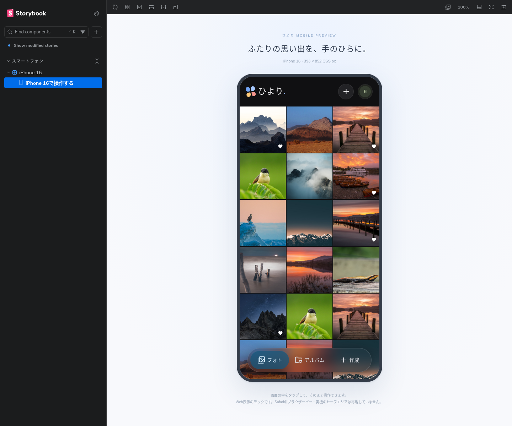

# 外観設定とiPhone 16の仕様レビュー（Issue #44・#46）

本書のレビュー用prop・未実装の説明は仕様PR時点の履歴です。2026-11-12にPOが仕様PR #45を承認・マージし、製品実装を指示しました。現在の実装と検証は[実装検証記録](issue-44-validation.md)を参照してください。

製品ルールと保存・フォールバックの案は[製品仕様第16節](product.md#16-issue-44外観設定承認済み)。API変更なし。ブラウザ内の外観設定のためOpenAPI・DB・認証・写真保存・依存ライブラリは変更しない。

## レビュー方法

`pnpm storybook` から **スマートフォン / iPhone 16 / iPhone 16で操作する** を開く。画面の正は `apps/frontend/src/IPhone16.stories.tsx`。Storybookのメニューはこの1件だけとし、過去デザイン・画面別・Issue別・環境確認のStoryは削除した。

画像でPOが指定した393×852の端末プレビューをメインとし、写真・詳細・アルバム・アップロード・長押し選択・お気に入り・ゴミ箱を画面内で操作する。外観設定は右上アカウントメニューから自動／ライト／ダークを選ぶ。写真詳細の鑑賞領域は両配色で暗色とする。

自動の配色はブラウザの外観設定を使用し、開いている間の変更も反映する。DevToolsのprefers-color-schemeエミュレーションでも確認できる。手動選択はシステムより優先し、自動へ戻すと最新の設定を適用する。これはStory内のレビュー用接続で、通常アプリの動作変更ではない。

## 範囲・通常アプリへの影響

共通Appと外観部品を使用する。通常起動はダーク固定を維持し、StoryでだけappearancePreviewを指定する。選択はメモリ内の一時状態。localStorage保存・別タブ同期・不正値／保存不可の処理・初回描画・theme-color制御は、合意後の製品実装PRで扱う。保存不可案内の部品は保持するが、専用Storyは削除した。

2026-11-12のPOの「いいよ」と追加指示に基づき、初回案の画面別・Issue別Storyを廃止し、「iPhoneの画面がメインであとは不要」を反映した。以前の画面レビュー記録は当時のコミットで参照できる。PRのマージ・本番反映は別承認。

## 検証分担

AIは仕様PRでStorybook型検査・ビルド、単一Storyの掲載、端末内の外観切替・写真・アルバム・複数選択・アップロードとプレビュー再読込、スマホ幅を検証する。単体・実APIテストは維持し、削除したStoryのみに依存する旧ブラウザテストは新しい単一プレビューのテストへ置き換える。

製品実装PRでは実アプリのOS変更追従、手動優先・自動復帰、再訪問保持、保存不可・不正値・matchMedia非対応、別タブ更新・キー削除、初回描画・theme-color、主要写真操作を検証する。Windows・iOS Safari実機・safe area・実Tailscaleは本番適用前にPOが確認する案。

## 最終整理の検証結果

- Storybook型検査・静的ビルド・OpenAPIを含むレビュー資料生成、全workspace型検査、整形、lint、Knip、配信テスト5件に成功。
- 新しいPlaywright全5件成功。掲載Storyが1件だけ、PCのメニューから393×852の端末表示、1440px・393px・320pxの親画面で端末内の外観・写真詳細・所属パネル・長押し選択・一括追加ダイアログ・アルバム・アップロード、読み込み失敗後の再読込を確認。アドオンパネル非表示も確認。
- 既存のフロント単体全60件とcoverage基準に成功（文88%、分岐86.64%、関数83.93%、行89.08%）。初回はブラウザ試験との同時実行中に既存1件が5秒タイムアウトし、単独の再実行で成功した。
- ブラウザ試験の初回はメニューの初期起動待機と読み込み障害の再表示に失敗。初期起動を20秒まで待つようにし、再実行で全成功。最終状態のスクリーンショットを目視確認済み。
- 旧Story用のブラウザテストは削除し、新しい単一入口のテストに置換。フロント単体・API・実DB結合・実API E2Eのテストソースは維持。実DB・本番・iOS Safari実機は今回未実施。
- 過去デザインに関連するGitHub Issue #8・#20・#21・#22・#23・#26・#41は既にクローズ済み。履歴の削除や再オープンはせず、整理用Issue #46に状態と新しい参照先を記録。
