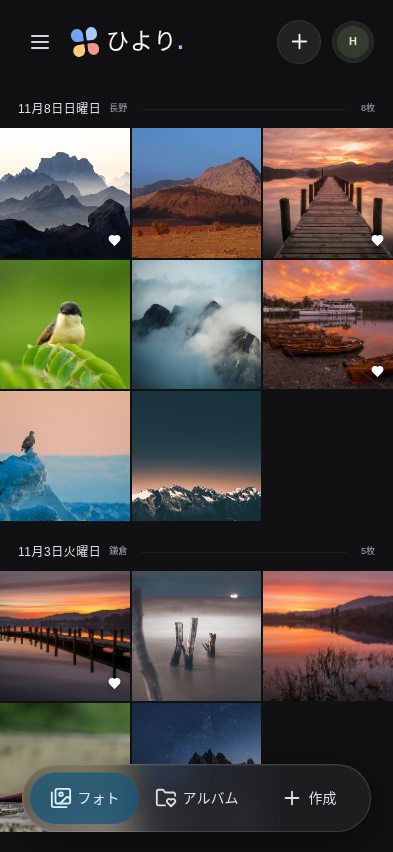
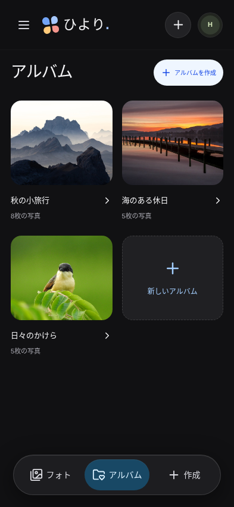
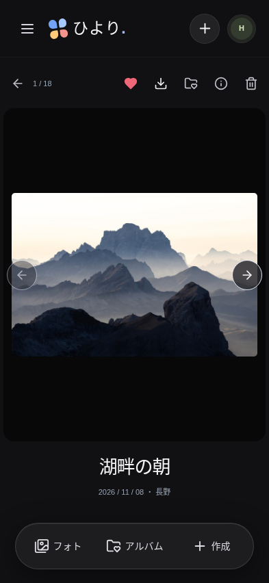
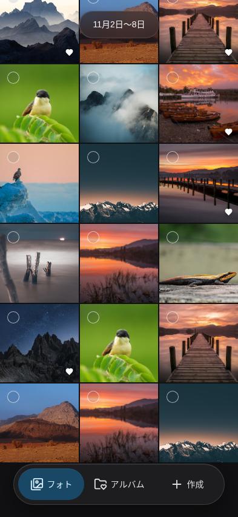
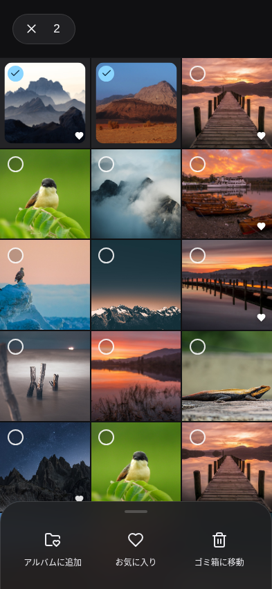
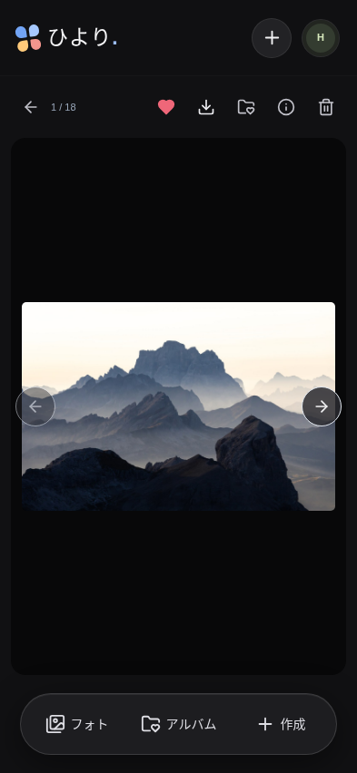
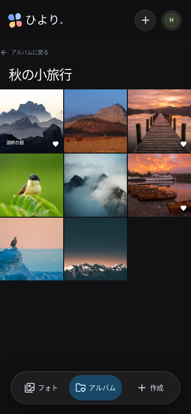

# スマホアプリ風ダークUIのレビュー案（Issue #41）

2026-11-11のPOからの画面モックPR作成依頼に基づく提案。参考画像の黒基調、写真中心のグリッド、半透明の下部ナビを取り入れる。参考の「コレクション」は既存の「アルバム」に対応させる。正式な製品UI採用・マージ・本番反映の承認は含まない。

## レビュー方法

`pnpm storybook` で **デザイン提案 / モバイルダーク / iPhone 16で操作する** を開く。PCでも393×852 CSS pxのiframe内でアプリを操作できる。「フォト」「アルバム」「アルバムの中」「写真詳細」「写真を追加」「写真なし」「読み込み中」「読み込み失敗」の各Storyでは画面・状態を直接確認できる。表示と操作状態の正は [MobileDark.stories.tsx](../apps/frontend/src/MobileDark.stories.tsx)。

1. フォトを開き、3列の連続グリッドを確認する。日付の見出しや日付間の余白を入れず、週の境界でも行を継続する。フォト見出し・総枚数・表示密度切替・絞り込み・並び順のツールバーは表示せず、ヘッダー直下から写真一覧を表示する（POの追加依頼に対応）。
2. 下部のアルバムから一覧・中身を開く。作成から新しいアルバムを作る。
3. 写真を開き、お気に入り、情報、アルバム所属、ダウンロード、削除を確認する。
4. 上部の＋から既存の写真追加フローを開く。検索バーは最新mainの仕様に従い表示しない。
5. 写真の長押しから複数選択へ入り、一括アルバム追加・お気に入り・ゴミ箱への移動を操作する。

## 画面例

| フォト                                   | アルバム                                   | 写真詳細                                   |
| ---------------------------------------- | ------------------------------------------ | ------------------------------------------ |
|  |  |  |

## 影響範囲

専用Storyだけが共通Appの `designPreview` を有効にする。通常起動と既存Storyの既定値はfalse。共通Appに任意の表示切替と下部ナビの組み替えを追加するため、その部分はレビュー対象となる。API・DB・認証・保存処理・依存パッケージの変更はない。新しい通知・AI機能は追加しない。

スタイルは `.mobile-dark` 内へ限定し、Radixがbodyへ描画するダイアログだけ `body:has(.mobile-dark)` で配色を適用する。既存iPhoneプレビューを再利用して専用Storyを表示する。Storybookでは既存の架空フィクスチャとMSWを使用する。

ヘッダーはスクロールに追従せず、写真一覧とともに画面外へ流れる。下部ナビは背景の不透明度を約72%から35%へ下げ、ぼかしを28pxから18pxへ弱めて背後の写真を見せる。文字・アイコンの不透明度は維持する。

下部ナビは44px以上の操作領域・safe area用余白を持ち、最終行がナビの上までスクロールできる。Safari実機、ブラウザーのアドレスバー、実端末のsafe areaやキーボードは別途確認が必要。Web表示の提案であり、OSのステータスバーを画面内に複製しない。

## スクロール時のアップロード期間

フォトは `createdAt` の新しい順で写真を1つのグリッドに並べる。撮影日や従来の `date` で日付見出しを挟まない。ヘッダーが画面外へ流れた後、上部に固定した半透明のラベルで上端の写真のアップロード週を示す。週はUTCの月曜日〜日曜日とし、当週は「今週」、過去は「11月2日〜8日」、月・年をまたぐ場合は月・年も表示する。日付の基準はラベルのアクセシブル名にも明記する。スクロールを戻してヘッダーが見えるとラベルを隠す。ラベルはタップを妨げない。

専用Storyのサンプルはアップロード日時を架空の日付に分散させる。通常Storyのフィクスチャは維持し、APIや保存処理は変更しない。

## 長押しによる複数選択

**デザイン提案 / モバイルダーク / 長押し後の複数選択** から、1枚を選択した状態を直接レビューできる。

通常は写真左上の丸を描画しない。写真を500ms長押しするとその写真を選択して選択モードへ入り、すべての写真に丸を表示する。以後の写真タップは詳細を開かず選択・解除する。長押し後の指を離す操作で詳細が開いたり選択が解除されたりしない。10pxを超える指の移動、スクロール、ポインターキャンセル・画面離脱では長押しを取り消す。縦スクロールを妨げず、iOSの画像メニューとドラッグを抑える。

選択中は上部を「×・選択数」のピルに置き換え、下部ナビの代わりに操作パネルを固定表示する。既存のアルバム追加・お気に入り・ゴミ箱への移動を使い、削除確認や失敗時の再試行は共通のダイアログで扱う。0枚まで解除しても選択モードは維持し、操作を無効にする。「×」で選択モードを終了する。保存・一括移動の成功、画面遷移でも終了する。キーボードでは写真にフォーカスしてShift+EnterまたはShift+Spaceで選択を開始できる。

## サイドバーの撤去

専用モックはサイドバーとそれを開くメニューボタンを描画しない。PCでも写真一覧の左側に空白を残さず、フォト・アルバム・作成の下部ナビとヘッダーの写真追加を表示する。サイドバーにあったお気に入り一覧・ゴミ箱一覧への直接リンクは今回の案では表示しない。通常アプリのサイドバーは変更しない。

## 写真詳細のスワイプ

専用モックの写真詳細では初期状態の左右の矢印と写真下のタイトル・日付・場所を表示しない。写真をタップすると左右の矢印を表示し、再タップで隠す。矢印の表示状態は前後の写真へ移動しても維持し、一覧へ戻ると初期状態に戻す。画像の代替テキストと「写真の情報」パネルは維持する。写真上で左へスワイプすると次、右へスワイプすると前の写真へ移動する。横移動50px以上かつ縦移動の1.5倍を超える場合に限り判定し、短いタップ・縦スクロール・複数指・キャンセルでは移動しない。最初と最後では折り返さない。キーボードの左右キーは従来どおり使える。通常アプリの矢印・キャプションは維持する。

写真詳細は動的ビューポート（100dvh）内に固定し、上下スクロール・背景のスクロール連鎖を抑える。写真領域も1本指の縦移動をページスクロールへ渡さず、ピンチズームを許可する。上部操作と下部ナビを除く残りの高さへ写真を収める。情報パネルやダイアログの内部スクロールは維持する。タップとスワイプを区別し、スワイプや移動後の指を離す操作では矢印を切り替えない。キーボードは写真領域にフォーカスしてEnter/Spaceでも矢印を切り替えられる。

## アルバム内も連続グリッドへ統一

専用モックのアルバム内もフォトと同じ連続グリッドとアップロード期間表示を使う。日付の見出し・枚数・すべて/お気に入りの絞り込み・並び順・表示密度切替を表示しない。アルバム名と「アルバムに戻る」は残し、写真の長押し・詳細操作も共用する。通常アプリの表示は維持する。

## 写真詳細の戻り先

写真を開いた一覧のパスをルーターのstateに保存する。スワイプ・矢印・左右キーで別の写真へ進むときも戻り先を引き継ぎ、写真移動では詳細の履歴を置き換える。詳細の戻るボタンとEscapeは元のアルバム・フォト・お気に入り・ゴミ箱へ戻る。写真が属するアルバムから戻り先を推測しない。詳細の直接表示など戻り先がない場合は、通常の写真ならフォト、削除済みならゴミ箱へ戻る。API変更なし。
